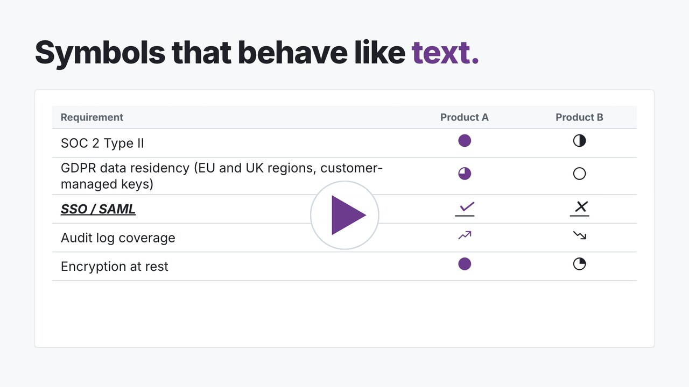
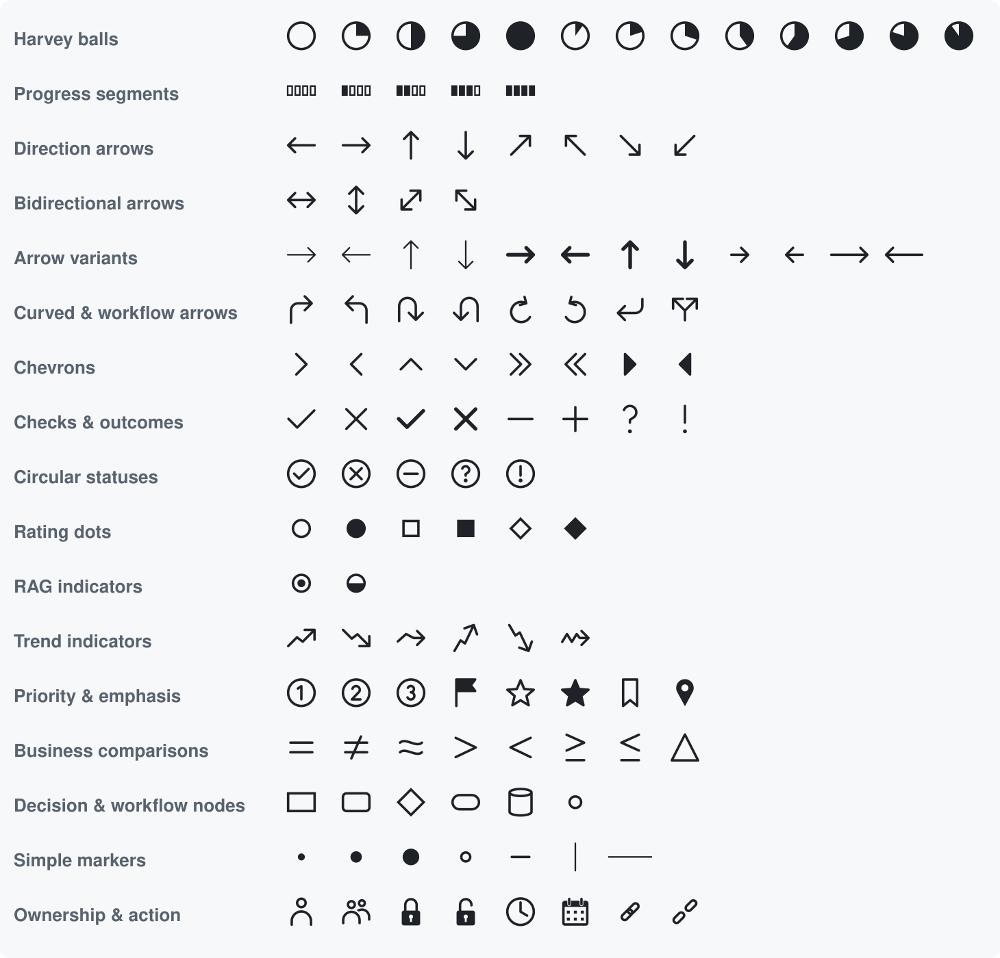

# SlideMarks

**Presentation symbols that behave like text.** Harvey balls, arrows, checks, ratings, trends and more for PowerPoint and Word tables. You can type, paste, resize, recolor and align them like any other character.

[](https://vimeo.com/1243908122)

*[Watch the 1-minute video](https://vimeo.com/1243908122): icons vs SlideMarks in a PowerPoint table, then Word. Click sound: "Single click mouse" by ScouseMouseJB, [CC BY 4.0](https://creativecommons.org/licenses/by/4.0/).*


- **One consistent family.** Every Harvey ball has the same size, every arrow the same head, and every glyph the same stroke weight and center. Symbols line up in table cells without per-cell nudging.
- **It's a font.** Change size and color with the normal text controls. Unfilled areas are transparent, so the cell background shows through.
- **Works offline.** No account, add-in or internet connection needed.

122 glyphs in 17 families. See the **[glyph reference](docs/glyphs.md)** for every symbol with its code point.



**Website and downloads:** https://pjaol.github.io/SlideMarks/

> **Status:** pre-release (v0.1.0). Glyphs marked *candidate* in the reference may change or be removed before 1.0; all others keep their code points.

## Download

Download the repository (**Code → Download ZIP**). The files you need are in the `dist/` folder:

| File | Use it for |
|---|---|
| `dist/fonts/SlideMarks-Regular.ttf` | Installing on Windows, macOS or Linux |
| `dist/web/` | Websites: `SlideMarks-Regular.woff2`, `slidemarks.css`, `slidemarks.json` (symbol data and labels), `example.html` |
| `dist/svg/` | One SVG per glyph, for design tools |
| `dist/screen-readers/` | Optional pronunciation packs for VoiceOver, NVDA and JAWS |

## Install the font

The easiest way is the one-step installer on the [website](https://pjaol.github.io/SlideMarks/#install). It installs the font and adds the SlideMarks add-in to Word and PowerPoint:

- **Mac:** download the [Mac installer](https://github.com/pjaol/SlideMarks/releases/latest/download/SlideMarks.pkg), or run `curl -fsSL https://pjaol.github.io/SlideMarks/install.sh | sh` in Terminal.
- **Windows:** run `irm https://pjaol.github.io/SlideMarks/install.ps1 | iex` in PowerShell.

To install only the font:

- **Windows:** right-click `SlideMarks-Regular.ttf` → **Install** (or **Install for all users**). Restart PowerPoint or Word.
- **macOS:** double-click `SlideMarks-Regular.ttf` → **Install Font**. Restart PowerPoint or Word.
- **Linux:** copy the file to `~/.local/share/fonts/` and run `fc-cache -f`.

## Use it in PowerPoint and Word

### Typing a symbol

SlideMarks symbols live in the Unicode Private Use Area. **They only appear as the right shapes when the text is set to the SlideMarks font.**

- **Insert → Symbol** (Windows: **Symbol → More Symbols**; Mac: **Advanced Symbol**). Choose **SlideMarks** as the font, then pick the glyph. Works in PowerPoint and Word on Windows and Mac.
- **Word on Windows:** type the code point from the [glyph reference](docs/glyphs.md) (e.g. `E002`), then press **Alt+X**. Set the character's font to SlideMarks.
- **Copy and paste** from the [web picker](https://pjaol.github.io/SlideMarks/picker/) carries the SlideMarks font. In **PowerPoint**, choose **Paste Options → Keep Source Formatting** after pasting, because PowerPoint's default paste switches to the theme font. If a pasted symbol still shows as a box, set its font to SlideMarks.

**Arrows and comparison signs also work as ordinary characters.** With SlideMarks applied, `→ ← ↑ ↓ ↔ ≤ ≥ ≠` and friends draw the SlideMarks versions. Prefer these: screen readers can name standard characters (results vary by reader, so see the [test results](docs/accessibility.md#test-results)), and they still make sense if the font is missing. The glyph reference lists them under *Standard Unicode*.

### Tables

The easiest workflow: select the table cells or columns that will hold symbols and set their font to **SlideMarks** *first*. Anything you insert or paste there then shows correctly. Use the normal alignment buttons; the glyphs are designed to center in a cell.

### Accessibility

Screen readers can't describe most symbols on their own, so **pair each symbol with text**: put the value next to it (a Harvey ball followed by "75%", a check followed by "Done"), or add a legend.

To find symbols without readable text, PUA arrows that should be standard characters, missing header rows and fonts that aren't embedded, run `uv run slidemarks check deck.pptx`. It needs the developer tools for now; see [docs/accessibility.md](docs/accessibility.md#checking-a-document).

Screen-reader users can also install a **pronunciation pack** (`dist/screen-readers/`) so each symbol is spoken by its meaning, e.g. "Harvey ball 50 percent". See [docs/accessibility.md](docs/accessibility.md) for the packs and for authoring patterns in PowerPoint, Word, PDF and the web.

### Size and color

Change them exactly as you would for text. The whole glyph takes the text color, and the unfilled parts (such as the empty part of a Harvey ball) stay transparent.

## Sharing documents

People who open your file need the font too. Either they install it, or you **embed it in the file**:

- **Windows:** **File → Options → Save → Embed fonts in the file**, and choose **Embed all characters** so recipients can edit.
- **Mac:** **PowerPoint / Word → Preferences → Save → Embed fonts in the file**.

Embedding has been tested in PowerPoint and Word on Mac and Windows. PowerPoint for Mac drops embedded fonts when it re-saves a file unless that setting is on.

If a recipient sees **empty boxes**, the font is missing. That's expected behavior for a symbol font: the box means "install or embed SlideMarks", not a different symbol.

## Use it on a website

Copy `dist/web/` into your site and include the stylesheet:

```html
<link rel="stylesheet" href="web/slidemarks.css">

<!-- decorative: the text carries the meaning -->
<span class="slidemarks sm-harvey-75" aria-hidden="true"></span> 75% complete

<!-- meaningful on its own: give it a role and a name -->
<span class="slidemarks sm-harvey-75" role="img" aria-label="Harvey ball 75 percent"></span>
```

Every glyph has a class `sm-<id>`. Glyph classes are decorative by default.
- `dist/web/slidemarks.json` lists every symbol with its character, code points, CSS class and spoken label, so you can label symbols from data.
- `dist/web/example.html` shows the accessible patterns working.
- See [accessibility](docs/accessibility.md#web) for font overrides, contrast and color.

The font is self-hosted, so the site makes no third-party requests.

## Limitations

- **Google Slides** and the **web versions of Office** may not use the embedded font and can show empty boxes instead.
- Copy and paste carries the *character*, not the font. Set the destination to SlideMarks.
- Screen readers can't read most SlideMarks symbols (see [accessibility](docs/accessibility.md)); pair symbols with text.
- Office add-ins for one-click insertion are planned but not available yet.

## License

- **The font** (the font files and glyph designs): [SIL Open Font License 1.1](OFL.txt), with Reserved Font Name **"SlideMarks"**. Use it freely in any document, commercial or not, and embed it in files you share. Modified versions must use a different name.
- **The software** (add-in, picker, tools): [Apache License 2.0](LICENSE).
- **The name and logo:** see [TRADEMARKS.md](TRADEMARKS.md).

Details and third-party material are listed in [NOTICE](NOTICE).

All glyphs are original drawings generated from this project's own design tokens. No third-party font outlines or icon sets are included.

## Contributing

Building the font, the design review workflow and adding glyphs are covered in **[CONTRIBUTING.md](CONTRIBUTING.md)**.
