# SlideMarks glyph reference

Version 0.1.0 · 122 glyphs. Generated from `source/symbols.json`; do not edit by hand.

Code points are in the Unicode Private Use Area. They only show as these shapes when the **SlideMarks** font is applied. See the [README](../README.md#typing-a-symbol) for how to insert them.

Glyphs marked *candidate* may change or be removed before 1.0. All others keep their code points.

**Standard Unicode**: where a glyph has an exact standard equivalent, the font also answers to that character. Prefer it: it looks identical with SlideMarks applied, still means the right thing if the font is missing, and screen readers know its name. See [accessibility](accessibility.md).

| Family | |
|---|---|
| [Harvey balls](#harvey-balls) | 13 glyphs |
| [Progress segments](#progress-segments) | 5 glyphs |
| [Direction arrows](#direction-arrows) | 8 glyphs |
| [Bidirectional arrows](#bidirectional-arrows) | 4 glyphs |
| [Arrow variants](#arrow-variants) | 12 glyphs |
| [Curved & workflow arrows](#curved--workflow-arrows) | 8 glyphs |
| [Chevrons](#chevrons) | 8 glyphs |
| [Checks & outcomes](#checks--outcomes) | 8 glyphs |
| [Circular statuses](#circular-statuses) | 5 glyphs |
| [Rating dots](#rating-dots) | 6 glyphs |
| [RAG indicators](#rag-indicators) | 2 glyphs |
| [Trend indicators](#trend-indicators) | 6 glyphs |
| [Priority & emphasis](#priority--emphasis) | 8 glyphs |
| [Business comparisons](#business-comparisons) | 8 glyphs |
| [Decision & workflow nodes](#decision--workflow-nodes) | 6 glyphs |
| [Simple markers](#simple-markers) | 7 glyphs |
| [Ownership & action](#ownership--action) | 8 glyphs |

## Harvey balls

| | Name | Code point | Standard Unicode | Spoken label | CSS class | Status |
|---|---|---|---|---|---|---|
| 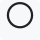 | Harvey ball 0% | `U+E000` | — | Harvey ball 0 percent | `sm-harvey-0` | draft |
| 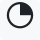 | Harvey ball 25% | `U+E001` | — | Harvey ball 25 percent | `sm-harvey-25` | draft |
|  | Harvey ball 50% | `U+E002` | — | Harvey ball 50 percent | `sm-harvey-50` | draft |
|  | Harvey ball 75% | `U+E003` | — | Harvey ball 75 percent | `sm-harvey-75` | draft |
|  | Harvey ball 100% | `U+E004` | — | Harvey ball 100 percent | `sm-harvey-100` | draft |
| 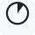 | Harvey ball 10% | `U+E005` | — | Harvey ball 10 percent | `sm-harvey-10` | draft |
|  | Harvey ball 20% | `U+E006` | — | Harvey ball 20 percent | `sm-harvey-20` | draft |
| 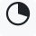 | Harvey ball 30% | `U+E007` | — | Harvey ball 30 percent | `sm-harvey-30` | draft |
|  | Harvey ball 40% | `U+E008` | — | Harvey ball 40 percent | `sm-harvey-40` | draft |
|  | Harvey ball 60% | `U+E009` | — | Harvey ball 60 percent | `sm-harvey-60` | draft |
|  | Harvey ball 70% | `U+E00A` | — | Harvey ball 70 percent | `sm-harvey-70` | draft |
|  | Harvey ball 80% | `U+E00B` | — | Harvey ball 80 percent | `sm-harvey-80` | draft |
|  | Harvey ball 90% | `U+E00C` | — | Harvey ball 90 percent | `sm-harvey-90` | draft |

## Progress segments

| | Name | Code point | Standard Unicode | Spoken label | CSS class | Status |
|---|---|---|---|---|---|---|
| 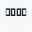 | Progress 0 of 4 | `U+E010` | — | progress 0 of 4 | `sm-progress-0-4` | draft |
| 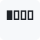 | Progress 1 of 4 | `U+E011` | — | progress 1 of 4 | `sm-progress-1-4` | draft |
| 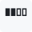 | Progress 2 of 4 | `U+E012` | — | progress 2 of 4 | `sm-progress-2-4` | draft |
| 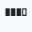 | Progress 3 of 4 | `U+E013` | — | progress 3 of 4 | `sm-progress-3-4` | draft |
| 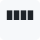 | Progress 4 of 4 | `U+E014` | — | progress 4 of 4 | `sm-progress-4-4` | draft |

## Direction arrows

| | Name | Code point | Standard Unicode | Spoken label | CSS class | Status |
|---|---|---|---|---|---|---|
| 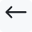 | Arrow left | `U+E020` | `U+2190` | left arrow | `sm-arrow-left` | draft |
| 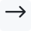 | Arrow right | `U+E021` | `U+2192` | right arrow | `sm-arrow-right` | draft |
| 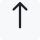 | Arrow up | `U+E022` | `U+2191` | up arrow | `sm-arrow-up` | draft |
|  | Arrow down | `U+E023` | `U+2193` | down arrow | `sm-arrow-down` | draft |
| 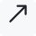 | Arrow north-east | `U+E024` | `U+2197` | up-right arrow | `sm-arrow-ne` | draft |
| 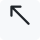 | Arrow north-west | `U+E025` | `U+2196` | up-left arrow | `sm-arrow-nw` | draft |
| 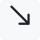 | Arrow south-east | `U+E026` | `U+2198` | down-right arrow | `sm-arrow-se` | draft |
| 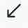 | Arrow south-west | `U+E027` | `U+2199` | down-left arrow | `sm-arrow-sw` | draft |

## Bidirectional arrows

| | Name | Code point | Standard Unicode | Spoken label | CSS class | Status |
|---|---|---|---|---|---|---|
| 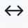 | Arrow left-right | `U+E028` | `U+2194` | left-right arrow | `sm-arrow-left-right` | draft |
| 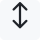 | Arrow up-down | `U+E029` | `U+2195` | up-down arrow | `sm-arrow-up-down` | draft |
|  | Arrow north-east/south-west | `U+E02A` | `U+2922` | up-right and down-left arrow | `sm-arrow-ne-sw` | draft |
| 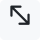 | Arrow north-west/south-east | `U+E02B` | `U+2921` | up-left and down-right arrow | `sm-arrow-nw-se` | draft |

## Arrow variants

| | Name | Code point | Standard Unicode | Spoken label | CSS class | Status |
|---|---|---|---|---|---|---|
| 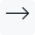 | Arrow right thin | `U+E02C` | — | thin right arrow | `sm-arrow-right-thin` | draft |
| 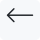 | Arrow left thin | `U+E02D` | — | thin left arrow | `sm-arrow-left-thin` | draft |
|  | Arrow up thin | `U+E02E` | — | thin up arrow | `sm-arrow-up-thin` | draft |
| 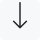 | Arrow down thin | `U+E02F` | — | thin down arrow | `sm-arrow-down-thin` | draft |
|  | Arrow right heavy | `U+E030` | — | heavy right arrow | `sm-arrow-right-heavy` | draft |
|  | Arrow left heavy | `U+E031` | — | heavy left arrow | `sm-arrow-left-heavy` | draft |
|  | Arrow up heavy | `U+E032` | — | heavy up arrow | `sm-arrow-up-heavy` | draft |
|  | Arrow down heavy | `U+E033` | — | heavy down arrow | `sm-arrow-down-heavy` | draft |
| 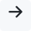 | Arrow right short | `U+E034` | — | short right arrow | `sm-arrow-right-short` | draft |
|  | Arrow left short | `U+E035` | — | short left arrow | `sm-arrow-left-short` | draft |
| 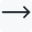 | Arrow right long | `U+E036` | — | long right arrow | `sm-arrow-right-long` | draft |
| 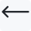 | Arrow left long | `U+E037` | — | long left arrow | `sm-arrow-left-long` | draft |

## Curved & workflow arrows

| | Name | Code point | Standard Unicode | Spoken label | CSS class | Status |
|---|---|---|---|---|---|---|
| 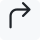 | Turn right | `U+E038` | — | turn right arrow | `sm-arrow-turn-right` | draft |
| 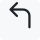 | Turn left | `U+E039` | — | turn left arrow | `sm-arrow-turn-left` | draft |
|  | U-turn right | `U+E03A` | — | U-turn right arrow | `sm-arrow-uturn-right` | draft |
|  | U-turn left | `U+E03B` | — | U-turn left arrow | `sm-arrow-uturn-left` | draft |
|  | Loop clockwise | `U+E03C` | — | clockwise loop arrow | `sm-arrow-loop-cw` | draft |
| 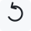 | Loop counter-clockwise | `U+E03D` | — | counter-clockwise loop arrow | `sm-arrow-loop-ccw` | draft |
| 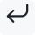 | Return | `U+E03E` | — | return arrow | `sm-arrow-return` | draft |
|  | Branch | `U+E03F` | — | branch arrow | `sm-arrow-branch` | draft |

## Chevrons

| | Name | Code point | Standard Unicode | Spoken label | CSS class | Status |
|---|---|---|---|---|---|---|
|  | Chevron right | `U+E040` | — | right chevron | `sm-chevron-right` | draft |
|  | Chevron left | `U+E041` | — | left chevron | `sm-chevron-left` | draft |
|  | Chevron up | `U+E042` | — | up chevron | `sm-chevron-up` | draft |
|  | Chevron down | `U+E043` | — | down chevron | `sm-chevron-down` | draft |
|  | Double chevron right | `U+E044` | — | double right chevron | `sm-chevron-double-right` | draft |
|  | Double chevron left | `U+E045` | — | double left chevron | `sm-chevron-double-left` | draft |
|  | Filled chevron right | `U+E046` | — | filled right chevron | `sm-chevron-filled-right` | draft |
|  | Filled chevron left | `U+E047` | — | filled left chevron | `sm-chevron-filled-left` | draft |

## Checks & outcomes

| | Name | Code point | Standard Unicode | Spoken label | CSS class | Status |
|---|---|---|---|---|---|---|
|  | Check | `U+E050` | — | check mark | `sm-status-check` | draft |
|  | Cross | `U+E051` | — | cross | `sm-status-cross` | draft |
|  | Heavy check | `U+E054` | — | heavy check mark | `sm-status-check-heavy` | draft |
|  | Heavy cross | `U+E055` | — | heavy cross | `sm-status-cross-heavy` | draft |
| 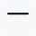 | Minus | `U+E056` | — | minus | `sm-status-minus` | draft |
| 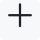 | Plus | `U+E057` | — | plus | `sm-status-plus` | draft |
|  | Question | `U+E058` | — | question mark | `sm-status-question` | draft |
|  | Exclamation | `U+E059` | — | exclamation mark | `sm-status-exclamation` | draft |

## Circular statuses

| | Name | Code point | Standard Unicode | Spoken label | CSS class | Status |
|---|---|---|---|---|---|---|
|  | Circle check | `U+E05A` | — | check mark in circle | `sm-circle-check` | draft |
|  | Circle cross | `U+E05B` | — | cross in circle | `sm-circle-cross` | draft |
|  | Circle minus | `U+E05C` | — | minus in circle | `sm-circle-minus` | draft |
|  | Circle question | `U+E05D` | — | question mark in circle | `sm-circle-question` | draft |
| 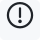 | Circle exclamation | `U+E05E` | — | exclamation mark in circle | `sm-circle-exclamation` | draft |

## Rating dots

| | Name | Code point | Standard Unicode | Spoken label | CSS class | Status |
|---|---|---|---|---|---|---|
| 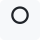 | Empty dot | `U+E052` | — | empty rating dot | `sm-dot-empty` | draft |
|  | Filled dot | `U+E053` | — | filled rating dot | `sm-dot-filled` | draft |
| 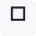 | Empty square | `U+E060` | — | empty rating square | `sm-square-empty` | draft |
|  | Filled square | `U+E061` | — | filled rating square | `sm-square-filled` | draft |
| 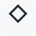 | Empty diamond | `U+E062` | — | empty rating diamond | `sm-diamond-empty` | draft |
|  | Filled diamond | `U+E063` | — | filled rating diamond | `sm-diamond-filled` | draft |

## RAG indicators

| | Name | Code point | Standard Unicode | Spoken label | CSS class | Status |
|---|---|---|---|---|---|---|
|  | RAG ring with dot | `U+E064` | — | RAG ring with centre dot | `sm-rag-ring-dot` | draft |
|  | RAG half-filled | `U+E065` | — | RAG half-filled dot | `sm-rag-half` | draft |

## Trend indicators

| | Name | Code point | Standard Unicode | Spoken label | CSS class | Status |
|---|---|---|---|---|---|---|
|  | Trend rising | `U+E070` | — | rising trend | `sm-trend-up` | draft |
|  | Trend falling | `U+E071` | — | falling trend | `sm-trend-down` | draft |
| 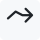 | Trend flat | `U+E072` | — | flat trend | `sm-trend-flat` | draft |
|  | Trend sharply rising | `U+E073` | — | sharply rising trend | `sm-trend-up-sharp` | draft |
| 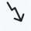 | Trend sharply falling | `U+E074` | — | sharply falling trend | `sm-trend-down-sharp` | draft |
| 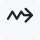 | Trend oscillating | `U+E075` | — | oscillating trend | `sm-trend-oscillating` | draft |

## Priority & emphasis

| | Name | Code point | Standard Unicode | Spoken label | CSS class | Status |
|---|---|---|---|---|---|---|
| 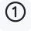 | Priority 1 | `U+E080` | — | priority 1 | `sm-priority-1` | draft |
| 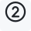 | Priority 2 | `U+E081` | — | priority 2 | `sm-priority-2` | draft |
| 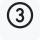 | Priority 3 | `U+E082` | — | priority 3 | `sm-priority-3` | draft |
|  | Flag | `U+E083` | — | flag | `sm-flag` | draft |
|  | Star outline | `U+E084` | — | empty star | `sm-star-outline` | draft |
|  | Star filled | `U+E085` | — | filled star | `sm-star-filled` | draft |
| 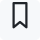 | Bookmark | `U+E086` | — | bookmark | `sm-bookmark` | draft |
|  | Pin | `U+E087` | — | pin | `sm-pin` | draft |

## Business comparisons

| | Name | Code point | Standard Unicode | Spoken label | CSS class | Status |
|---|---|---|---|---|---|---|
| 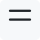 | Equals | `U+E090` | `U+003D` | equals | `sm-compare-equals` | draft |
| 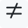 | Not equals | `U+E091` | `U+2260` | not equal to | `sm-compare-not-equals` | draft |
| 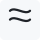 | Approximately | `U+E092` | `U+2248` | approximately equal to | `sm-compare-approx` | draft |
| 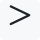 | Greater than | `U+E093` | `U+003E` | greater than | `sm-compare-greater` | draft |
| 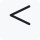 | Less than | `U+E094` | `U+003C` | less than | `sm-compare-less` | draft |
| 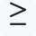 | Greater or equal | `U+E095` | `U+2265` | greater than or equal to | `sm-compare-greater-equal` | draft |
| 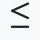 | Less or equal | `U+E096` | `U+2264` | less than or equal to | `sm-compare-less-equal` | draft |
| 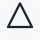 | Delta | `U+E097` | — | delta, change | `sm-compare-delta` | draft |

## Decision & workflow nodes

| | Name | Code point | Standard Unicode | Spoken label | CSS class | Status |
|---|---|---|---|---|---|---|
|  | Process | `U+E0A0` | — | process box | `sm-node-process` | candidate |
|  | Rounded process | `U+E0A1` | — | rounded process box | `sm-node-rounded` | candidate |
|  | Decision | `U+E0A2` | — | decision diamond | `sm-node-decision` | candidate |
|  | Terminator | `U+E0A3` | — | terminator | `sm-node-terminator` | candidate |
|  | Database | `U+E0A4` | — | database | `sm-node-database` | candidate |
|  | Connector | `U+E0A5` | — | connector | `sm-node-connector` | candidate |

## Simple markers

| | Name | Code point | Standard Unicode | Spoken label | CSS class | Status |
|---|---|---|---|---|---|---|
|  | Bullet small | `U+E0B0` | — | small bullet | `sm-marker-bullet-small` | draft |
|  | Bullet medium | `U+E0B1` | — | medium bullet | `sm-marker-bullet-medium` | draft |
|  | Bullet large | `U+E0B2` | — | large bullet | `sm-marker-bullet-large` | draft |
|  | Open bullet | `U+E0B3` | — | open bullet | `sm-marker-bullet-open` | draft |
|  | Dash | `U+E0B4` | — | dash | `sm-marker-dash` | draft |
|  | Vertical separator | `U+E0B5` | — | vertical separator | `sm-marker-separator-vertical` | draft |
|  | Horizontal separator | `U+E0B6` | — | horizontal separator | `sm-marker-separator-horizontal` | draft |

## Ownership & action

| | Name | Code point | Standard Unicode | Spoken label | CSS class | Status |
|---|---|---|---|---|---|---|
|  | User | `U+E0B8` | — | user | `sm-user` | candidate |
|  | Users | `U+E0B9` | — | users | `sm-users` | candidate |
|  | Lock | `U+E0BA` | — | lock | `sm-lock` | candidate |
|  | Unlock | `U+E0BB` | — | unlock | `sm-unlock` | candidate |
|  | Clock | `U+E0BC` | — | clock | `sm-clock` | candidate |
|  | Calendar | `U+E0BD` | — | calendar | `sm-calendar` | candidate |
|  | Link | `U+E0BE` | — | link | `sm-link` | candidate |
|  | Unlink | `U+E0BF` | — | unlink | `sm-unlink` | candidate |
